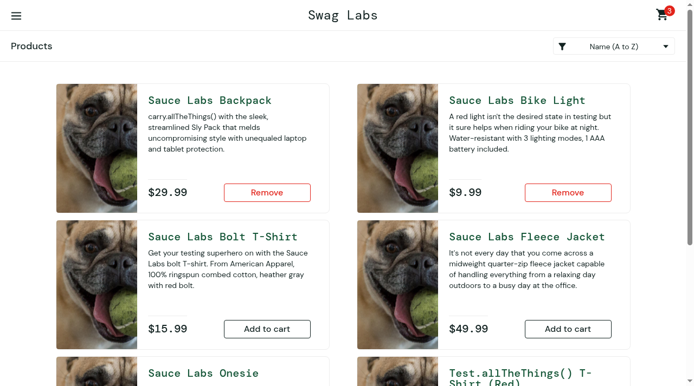

# BUG-001 - All product images render as the same placeholder image

| Field | Value |
| --- | --- |
| Severity | Major |
| Priority | Medium |
| Environment | SauceDemo, desktop Chrome, 1280x720 |
| Account | `problem_user` (passes on `standard_user`) |
| Found | 2026-10-18, exploratory session; reproduced 2/2 times |

## Summary

On the inventory page, every one of the 6 products displays the same
placeholder image (`sl-404-*.jpg`, a dog photo) instead of the product image.

## Steps to reproduce

1. Log in as `problem_user` / `secret_sauce`.
2. Observe the product images on `/inventory.html`.

## Expected

Each product shows its own image (compare `standard_user`: 6 distinct images -
backpack, bike light, t-shirt, jacket, onesie, red t-shirt).

## Actual

All 6 product images are byte-identical placeholder images
(1 distinct `src` across all 6, confirmed in the DOM). The placeholder loads
without error, so no broken-image indicator appears.

## Evidence

## Notes

The image `src` itself is wrong (a 404-named asset), not a loading failure.
Affects the inventory grid and would mislead any visual check of product
content. Related test case: TC-INV-002.
