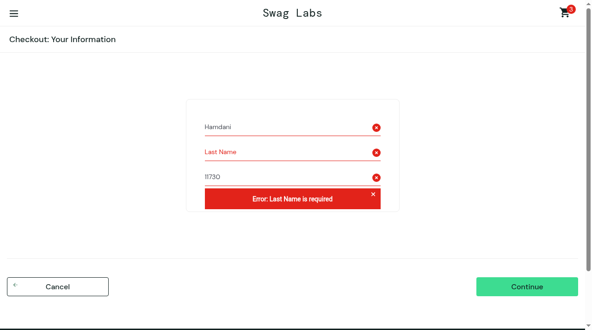

# BUG-004 - Checkout: Last Name input writes into First Name; checkout blocked

| Field | Value |
| --- | --- |
| Severity | Critical |
| Priority | High |
| Environment | SauceDemo, desktop Chrome, 1280x720 |
| Account | `problem_user` (passes on `standard_user`) |
| Found | 2026-10-18; reproduced 2/2 times |

## Summary

On the checkout information form, text typed into the **Last Name** field
lands in the **First Name** field instead, Last Name stays empty, and the
form rejects submission with "Error: Last Name is required". Checkout cannot
be completed.

## Steps to reproduce

1. Log in as `problem_user`, add a working item (e.g. Backpack) to the cart.
2. Cart -> Checkout.
3. Type `Dani` into First Name, `Hamdani` into Last Name, `11730` into
   Zip/Postal Code.
4. Click Continue.

## Expected

Each field holds its own value and the form advances to the overview page
(verified on `standard_user`, where the same input completes checkout with
"Thank you for your order!").

## Actual

First Name now contains `Hamdani` (overwriting `Dani`), Last Name is empty,
and submission fails with `Error: Last Name is required`.

## Evidence

## Notes

Makes checkout impossible for the account; blocks TC-CHK-001, TC-CHK-003,
TC-CHK-004 for `problem_user`.
